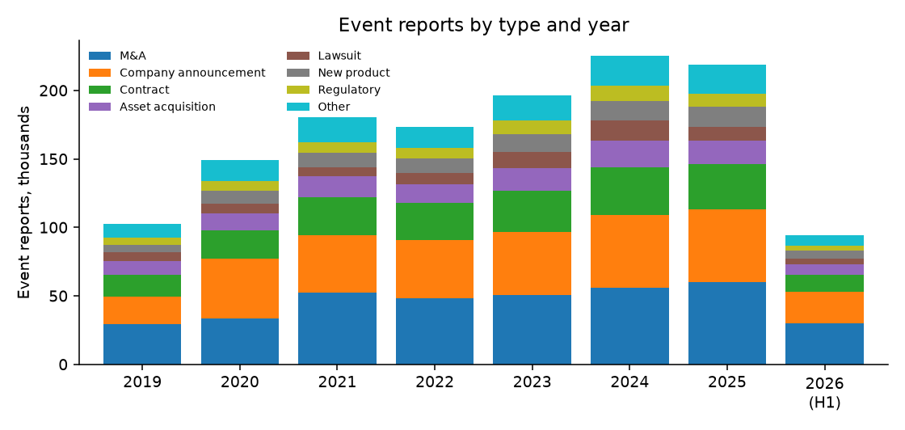
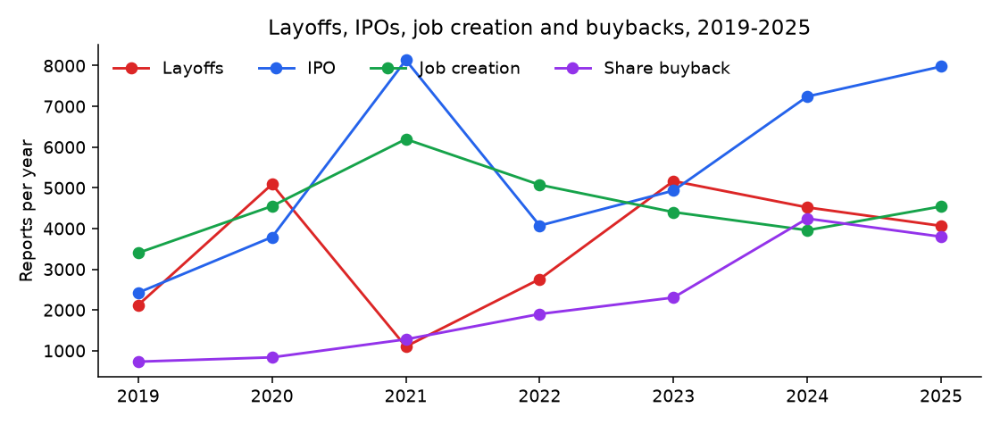
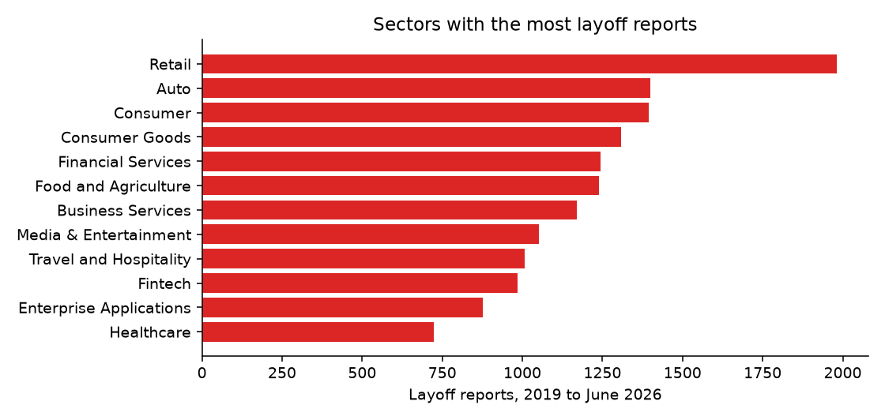

# Corporate Events 2019–2026: M&A, Layoffs, IPOs: findings, method and data card

*Fliar Research · released October 2026 · licence CC BY-NC 4.0*

**How this dataset was acquired.** Every row comes from the [Radar API](https://github.com/fliarbi/radar-api-mcp), Fliar's company-data API and MCP server. Radar reads
business news continuously, picks out sentences that report a corporate event (an acquisition, a contract win, a lawsuit, layoffs, an IPO,
a product launch, a regulatory decision and so on) and links each event to the company it concerns in a database of five million companies.
Where an event has two sides, Radar records which side the company was on: acquirer or target, contractor or client, plaintiff or defendant.
This release covers January 2019 to June 2026, with exact and same-day repeat reports removed. Each row carries the news sentence it was read
from and, where the article could be retrieved, its publisher and link. People-related events (leadership changes, board updates), earnings
and funding are left out; funding and capital raises are separate datasets. The full, continuously updated timeline for any company is
available through `POST /v1/companies/events` ([reference](https://github.com/fliarbi/radar-api-mcp/blob/main/docs/reference/get_company_events.md)) or the `get_company_events` MCP tool.

> **This file is a 7% sample: 100,002 of 1,339,579 event reports.** It keeps every record for a fixed subset of companies.
> The subset is chosen by a hash, so it stays the same from one release to the next. The findings and tables below were computed
> on the **full** data. For the rest, the withheld fields and monthly updates, [get a Radar API key](https://fliarbi.com/radar-api/developer) ([docs](https://github.com/fliarbi/radar-api-mcp)).
> Each row's `fliar_profile_url` opens the company's full profile on Fliar.

## Key findings

1. **1,339,579 event reports for 210,414 companies, January 2019 to June 2026.** The largest types are M&A (360,561), Company announcement (322,768), Contract (202,205), Asset acquisition (111,419).
2. **Layoff reports peaked in 2023** with 5,166 reports, against 2,122 in 2019 and 4,065 in 2025.
3. **IPO reports peaked in 2021** (8,136); 2025 had 7,978.
4. **M&A is two-sided:** 184,859 reports name the company as acquirer and 175,702 as target. The most active acquirer is KKR (651 reports), followed by Blackstone and ril.com.
5. **Coverage is concentrated:** the 50 most-reported companies hold 7.1% of all reports; Amazon alone has 10,280.
6. **Lawsuits:** 68,322 reports; the company is the defendant in 67% of those with a side.

### Events by type and year

Event reports after deduplication, full data. 2026 covers January to June.

| Event type           | 2019   | 2020   | 2021   | 2022   | 2023   | 2024   | 2025   | 2026 (H1)   | Total   |
|:---------------------|:-------|:-------|:-------|:-------|:-------|:-------|:-------|:------------|:--------|
| M&A                  | 29,525 | 33,452 | 52,632 | 48,114 | 50,346 | 56,167 | 60,272 | 30,053      | 360,561 |
| Company announcement | 19,998 | 43,675 | 41,643 | 42,310 | 46,371 | 52,994 | 53,105 | 22,672      | 322,768 |
| Contract             | 15,915 | 20,896 | 27,570 | 27,211 | 30,183 | 34,750 | 32,903 | 12,777      | 202,205 |
| Asset acquisition    | 9,930  | 12,221 | 15,268 | 14,031 | 16,226 | 19,128 | 17,150 | 7,465       | 111,419 |
| New product          | 5,072  | 9,151  | 10,562 | 10,701 | 13,211 | 14,608 | 14,987 | 6,030       | 84,322  |
| Lawsuit              | 6,466  | 7,180  | 6,807  | 7,738  | 11,670 | 14,839 | 9,724  | 3,898       | 68,322  |
| Regulatory           | 5,847  | 7,342  | 7,562  | 7,599  | 9,998  | 11,085 | 9,079  | 3,617       | 62,129  |
| IPO                  | 2,425  | 3,789  | 8,136  | 4,072  | 4,931  | 7,242  | 7,978  | 2,063       | 40,636  |
| Job creation         | 3,402  | 4,550  | 6,195  | 5,073  | 4,403  | 3,958  | 4,542  | 1,629       | 33,752  |
| Layoffs              | 2,122  | 5,087  | 1,102  | 2,758  | 5,166  | 4,519  | 4,065  | 1,588       | 26,407  |
| Share buyback        | 731    | 837    | 1,279  | 1,901  | 2,305  | 4,245  | 3,800  | 1,744       | 16,842  |
| Incorporation        | 727    | 971    | 1,440  | 1,823  | 1,275  | 1,201  | 990    | 412         | 8,839   |
| FDA approval         | 100    | 135    | 147    | 181    | 241    | 243    | 255    | 75          | 1,377   |

### Most-reported companies (top 50)

Large groups can appear under more than one domain (for example a national site), as resolved in the company database.

| #   | Company               | Domain                | Country              | Sector                          | Events   | M&A   | Contracts   | Lawsuits   | Layoffs   | New products   |
|:----|:----------------------|:----------------------|:---------------------|:--------------------------------|:---------|:------|:------------|:-----------|:----------|:---------------|
| 1   | Amazon                | amazon.com            | United States        | Retail                          | 10,280   | 311   | 540         | 1,280      | 204       | 1,061          |
| 2   | Boeing                | boeing.com            | United States        | Aerospace, Maritime and Defense | 4,264    | 67    | 857         | 302        | 98        | 20             |
| 3   | Apple                 | apple.com             | United States        | Consumer Goods                  | 4,127    | 144   | 169         | 475        | 37        | 168            |
| 4   | Walmart               | walmart.com           | United States        | Retail                          | 3,493    | 111   | 150         | 209        | 75        | 508            |
| 5   | Google                | google.com            | United States        | High Tech                       | 3,073    | 139   | 357         | 690        | 98        | 357            |
| 6   | General Motors        | gm.com                | United States        | Auto                            | 3,029    | 48    | 280         | 132        | 161       | 124            |
| 7   | Ford                  | ford.com              | United States        | Auto                            | 2,787    | 21    | 210         | 31         | 123       | 87             |
| 8   | Tesla                 | tesla.com             | United States        | Environment Tech                | 2,695    | 43    | 283         | 306        | 98        | 72             |
| 9   | Microsoft             | microsoft.com         | United Kingdom       | Enterprise Infrastructure       | 2,622    | 288   | 441         | 342        | 138       | 312            |
| 10  | Airbus                | airbus.com            | France               | Aerospace, Maritime and Defense | 2,615    | 70    | 758         | 93         | 57        | 7              |
| 11  | Starbucks             | starbucks.in          | India                | Food and Agriculture            | 2,506    | 22    | 39          | 139        | 30        | 287            |
| 12  | Facebook              | facebook.com          | United States        | Consumer                        | 2,414    | 80    | 92          | 760        | 13        | 416            |
| 13  | Samsung               | samsung.com           | South Korea          | Consumer Goods                  | 2,261    | 67    | 186         | 138        | 26        | 299            |
| 14  | Maruti Suzuki India   | marutisuzuki.com      | India                | Auto                            | 2,099    | 36    | 48          | 9          | 3         | 125            |
| 15  | Volkswagen            | volkswagen.de         | Germany              | Auto                            | 2,071    | 53    | 118         | 322        | 46        | 141            |
| 16  | ril.com               | ril.com               |                      |                                 | 2,012    | 528   | 212         | 150        | 7         | 60             |
| 17  | Meta                  | metavision.com        | United States        | High Tech                       | 1,930    | 90    | 128         | 332        | 139       | 455            |
| 18  | Tata Motors           | tatamotors.com        | India                | Auto                            | 1,838    | 61    | 146         | 35         | 4         | 312            |
| 19  | Petrobras             | petrobras.com.br      | Brazil               | Energy                          | 1,768    | 52    | 509         | 59         | 9         | 3              |
| 20  | Air India             | airindia.com          | India                | Travel and Hospitality          | 1,690    | 128   | 193         | 35         | 14        | 19             |
| 21  | TotalEnergies         | totalenergies.eg      | Egypt                | Energy                          | 1,579    | 128   | 425         | 27         | 1         | 4              |
| 22  | Target                | target.com            | United States        | Retail                          | 1,489    | 43    | 40          | 54         | 26        | 183            |
| 23  | Stellantis            | stellantis.com        | Netherlands          | Auto                            | 1,463    | 70    | 197         | 100        | 115       | 53             |
| 24  | Nestle                | nestle.com            | Switzerland          | Food and Agriculture            | 1,397    | 171   | 63          | 56         | 43        | 287            |
| 25  | Shell                 | shell.de              | Germany              | Energy                          | 1,363    | 102   | 317         | 67         | 19        | 18             |
| 26  | Blackstone            | blackstone.com        |                      |                                 | 1,330    | 591   | 38          | 23         | 0         | 2              |
| 27  | ALDI                  | aldi.hu               |                      | Conglomerates                   | 1,324    | 22    | 37          | 17         | 4         | 37             |
| 28  | Adani Group           | adanitransmission.com | India                | Energy                          | 1,281    | 373   | 104         | 137        | 1         | 4              |
| 29  | Toyota                | toyotaconnected.com   | United States        | Auto                            | 1,274    | 21    | 54          | 23         | 8         | 116            |
| 30  | Nvidia                | nvidia.com            | United States        | High Tech                       | 1,251    | 134   | 164         | 79         | 3         | 180            |
| 31  | Hyundai Motor Company | hyundai.com           | Germany              | Auto                            | 1,244    | 11    | 88          | 31         | 3         | 66             |
| 32  | TikTok                | tiktok.com            | United States        | Consumer                        | 1,218    | 171   | 71          | 155        | 30        | 213            |
| 33  | Huawei                | huawei.com            | China                | Telecom                         | 1,218    | 10    | 106         | 123        | 16        | 342            |
| 34  | Rio Tinto             | riotinto.com          | United Kingdom       | Mining                          | 1,207    | 92    | 320         | 27         | 3         | 1              |
| 35  | BYD                   | bydglobal.com         | China                | Energy Tech                     | 1,184    | 17    | 138         | 16         | 1         | 120            |
| 36  | Oracle                | oracle.com            | United States        | Enterprise Infrastructure       | 1,184    | 100   | 231         | 94         | 81        | 410            |
| 37  | Uber                  | uber.com              | United States        | Consumer                        | 1,175    | 130   | 77          | 88         | 40        | 313            |
| 38  | Foxconn               | foxconn.com.tw        |                      | Semiconductors                  | 1,156    | 23    | 86          | 30         | 8         | 2              |
| 39  | Chevron               | chevron.com           | United States        | Investment Industry             | 1,152    | 135   | 212         | 43         | 31        | 9              |
| 40  | IBM                   | ibm.com               | United States        | Enterprise Infrastructure       | 1,092    | 182   | 245         | 126        | 45        | 182            |
| 41  | ExxonMobil            | exxon.com             | United States        | Energy                          | 1,063    | 57    | 194         | 51         | 19        | 18             |
| 42  | KKR                   | kkr.com               |                      |                                 | 1,035    | 666   | 55          | 12         | 0         | 4              |
| 43  | Emirates              | emirates.com          | United Arab Emirates |                                 | 1,023    | 5     | 140         | 2          | 11        | 14             |
| 44  | SpiceJet              | spicejet.com          | India                | Travel and Hospitality          | 1,008    | 28    | 99          | 276        | 18        | 3              |
| 45  | OpenAI                | openai.com            | United States        | High Tech                       | 1,000    | 172   | 237         | 173        | 5         | 120            |
| 46  | AWS Lambda            | aws.amazon.com        | United States        | Enterprise Infrastructure       | 999      | 8     | 302         | 21         | 10        | 410            |
| 47  | United Airlines       | united.com            | United States        | Travel and Hospitality          | 996      | 17    | 139         | 10         | 55        | 13             |
| 48  | PepsiCo               | pepsico.com           | United States        | Food and Agriculture            | 995      | 125   | 76          | 57         | 23        | 128            |
| 49  | Kroger                | kroger.com            | United States        | Retail                          | 970      | 51    | 44          | 308        | 18        | 38             |
| 50  | Infosys               | infosys.com           | India                | Business Services               | 965      | 117   | 156         | 69         | 44        | 94             |

### Most active acquirers in M&A (top 50)

Counts are deduplicated news reports, not closed deals: one large deal reported on several days counts more than once.

| #   | Company                     | Country        | Sector                             | M&A reports as acquirer   | Asset acquisitions as buyer   | M&A reports as target   | Busiest year   | 2025 reports   |
|:----|:----------------------------|:---------------|:-----------------------------------|:--------------------------|:------------------------------|:------------------------|:---------------|:---------------|
| 1   | KKR                         |                |                                    | 651                       | 224                           | 15                      | 2024           | 110            |
| 2   | Blackstone                  |                |                                    | 573                       | 447                           | 18                      | 2024           | 91             |
| 3   | ril.com                     |                |                                    | 470                       | 160                           | 58                      | 2024           | 31             |
| 4   | Accenture                   | United States  | Investment Industry                | 454                       | 5                             | 2                       | 2021           | 43             |
| 5   | Adani Group                 | India          | Energy                             | 357                       | 164                           | 16                      | 2022           | 31             |
| 6   | Amazon                      | United States  | Retail                             | 308                       | 217                           | 3                       | 2021           | 31             |
| 7   | Bain Capital                |                |                                    | 308                       | 41                            | 6                       | 2025           | 84             |
| 8   | Apollo Global Management    |                |                                    | 302                       | 69                            | 2                       | 2024           | 49             |
| 9   | Microsoft                   | United Kingdom | Enterprise Infrastructure          | 270                       | 110                           | 18                      | 2022           | 15             |
| 10  | Advent International        |                |                                    | 254                       | 21                            | 3                       | 2025           | 54             |
| 11  | Thoma Bravo                 |                |                                    | 253                       | 26                            | 2                       | 2025           | 59             |
| 12  | Tata Group                  | India          | Conglomerates                      | 213                       | 108                           | 10                      | 2021           | 15             |
| 13  | EQT                         | United States  | Energy                             | 200                       | 32                            | 3                       | 2024           | 44             |
| 14  | Reliance Retail             | India          | Retail                             | 197                       | 26                            | 30                      | 2020           | 16             |
| 15  | Frasers Group               | United Kingdom | Retail                             | 186                       | 83                            | 1                       | 2023           | 18             |
| 16  | CVC                         |                |                                    | 185                       | 24                            | 9                       | 2024           | 20             |
| 17  | Carlyle                     | United States  | Consumer Goods                     | 175                       | 35                            | 10                      | 2025           | 37             |
| 18  | preservationgroup.com       |                |                                    | 174                       | 34                            | 12                      | 2025           | 43             |
| 19  | Berkshire Hathaway          | United States  | Conglomerates                      | 168                       | 70                            | 2                       | 2022           | 30             |
| 20  | IBM                         | United States  | Enterprise Infrastructure          | 166                       | 22                            | 16                      | 2024           | 19             |
| 21  | Brookfield Asset Management |                |                                    | 166                       | 183                           | 9                       | 2024           | 25             |
| 22  | Warburg Pincus              |                |                                    | 159                       | 27                            | 14                      | 2025           | 43             |
| 23  | H.I.G. Capital              |                |                                    | 157                       | 21                            | 1                       | 2025           | 41             |
| 24  | Platinum Equity             |                |                                    | 155                       | 18                            | 0                       | 2021           | 20             |
| 25  | Airtel                      | India          | Telecom                            | 154                       | 34                            | 46                      | 2019           | 29             |
| 26  | Nazara                      | India          | Mobile                             | 153                       | 6                             | 23                      | 2024           | 25             |
| 27  | Netflix                     | United States  | Media & Entertainment              | 147                       | 29                            | 37                      | 2025           | 90             |
| 28  | Zomato                      | India          | Food and Agriculture Tech          | 146                       | 13                            | 29                      | 2024           | 1              |
| 29  | Tata Steel                  | India          | Chemicals and Materials            | 146                       | 27                            | 9                       | 2022           | 22             |
| 30  | Goldman Sachs               | United States  | Investment Industry                | 143                       | 41                            | 14                      | 2025           | 43             |
| 31  | Reliance                    | Israel         | Real Estate and Construction Tech  | 139                       | 19                            | 18                      | 2021           | 7              |
| 32  | Apple                       | United States  | Consumer Goods                     | 136                       | 29                            | 8                       | 2019           | 16             |
| 33  | Tech Mahindra               | India          | Business Services                  | 135                       | 1                             | 7                       | 2021           | 1              |
| 34  | Google                      | United States  | High Tech                          | 135                       | 57                            | 4                       | 2020           | 28             |
| 35  | SGS                         | Switzerland    | Industrial Goods and Manufacturing | 134                       | 5                             | 5                       | 2023           | 38             |
| 36  | HUB International           | United States  | Financial Services                 | 134                       | 111                           | 1                       | 2019           | 6              |
| 37  | Apollo                      | United Kingdom | Energy                             | 133                       | 43                            | 11                      | 2024           | 25             |
| 38  | Tencent                     | China          |                                    | 129                       | 17                            | 5                       | 2020           | 13             |
| 39  | Assa Abloy                  | Sweden         | Real Estate and Construction Tech  | 128                       | 1                             | 12                      | 2025           | 21             |
| 40  | Brookfield                  |                | Food and Agriculture               | 124                       | 122                           | 3                       | 2024           | 14             |
| 41  | Wipro Consumer Care         | India          | Consumer Goods                     | 124                       | 4                             | 3                       | 2025           | 26             |
| 42  | Pfizer                      | United States  | Healthcare                         | 123                       | 13                            | 8                       | 2025           | 30             |
| 43  | morganstanley.com           |                |                                    | 122                       | 41                            | 4                       | 2024           | 16             |
| 44  | Nvidia                      | United States  | High Tech                          | 120                       | 29                            | 14                      | 2025           | 37             |
| 45  | Nestle                      | Switzerland    | Food and Agriculture               | 120                       | 32                            | 51                      | 2020           | 7              |
| 46  | Consortium                  |                | Consumer                           | 119                       | 24                            | 0                       | 2025           | 21             |
| 47  | Saudi Aramco                | Saudi Arabia   | Energy                             | 119                       | 82                            | 13                      | 2019           | 13             |
| 48  | BlackRock                   | United States  | Financial Services                 | 118                       | 54                            | 5                       | 2024           | 27             |
| 49  | Cisco                       | United States  | Enterprise Infrastructure          | 117                       | 4                             | 14                      | 2023           | 5              |
| 50  | Siemens                     | Germany        | Industrial Goods and Manufacturing | 117                       | 9                             | 22                      | 2024           | 8              |

### Layoff reports by sector and year (top 25 sectors)

| Sector                             | 2019   | 2020   | 2021   | 2022   | 2023   | 2024   | 2025   | 2026 (H1)   | Total   |
|:-----------------------------------|:-------|:-------|:-------|:-------|:-------|:-------|:-------|:------------|:--------|
| Retail                             | 172    | 399    | 56     | 214    | 395    | 279    | 323    | 143         | 1,981   |
| Auto                               | 191    | 222    | 76     | 61     | 237    | 253    | 289    | 70          | 1,399   |
| Consumer                           | 75     | 350    | 43     | 220    | 316    | 207    | 131    | 53          | 1,395   |
| Consumer Goods                     | 139    | 280    | 62     | 95     | 164    | 270    | 213    | 85          | 1,308   |
| Financial Services                 | 147    | 214    | 90     | 85     | 232    | 209    | 168    | 99          | 1,244   |
| Food and Agriculture               | 128    | 278    | 84     | 83     | 152    | 179    | 240    | 96          | 1,240   |
| Business Services                  | 88     | 206    | 35     | 79     | 224    | 205    | 249    | 84          | 1,170   |
| Media & Entertainment              | 68     | 190    | 41     | 118    | 224    | 201    | 150    | 59          | 1,051   |
| Travel and Hospitality             | 54     | 627    | 79     | 34     | 32     | 74     | 73     | 33          | 1,006   |
| Fintech                            | 38     | 110    | 21     | 220    | 330    | 152    | 64     | 49          | 984     |
| Enterprise Applications            | 38     | 89     | 21     | 139    | 277    | 156    | 114    | 43          | 877     |
| Healthcare                         | 59     | 94     | 35     | 60     | 152    | 142    | 126    | 56          | 724     |
| Enterprise Infrastructure          | 27     | 43     | 9      | 73     | 228    | 131    | 148    | 60          | 719     |
| High Tech                          | 29     | 59     | 10     | 97     | 205    | 108    | 103    | 79          | 690     |
| Energy                             | 68     | 179    | 41     | 40     | 49     | 96     | 143    | 14          | 630     |
| Life Sciences                      | 29     | 23     | 12     | 97     | 187    | 110    | 98     | 25          | 581     |
| Food and Agriculture Tech          | 31     | 58     | 8      | 135    | 148    | 82     | 47     | 23          | 532     |
| Telecom                            | 69     | 68     | 46     | 32     | 74     | 95     | 59     | 47          | 490     |
| Real Estate and Construction       | 33     | 88     | 21     | 24     | 83     | 89     | 81     | 34          | 453     |
| Healthtech                         | 27     | 48     | 6      | 81     | 106    | 56     | 40     | 7           | 371     |
| Semiconductors                     | 18     | 37     | 3      | 29     | 71     | 79     | 102    | 20          | 359     |
| Energy Tech                        | 23     | 34     | 7      | 32     | 81     | 99     | 60     | 20          | 356     |
| Aerospace, Maritime and Defense    | 12     | 184    | 26     | 5      | 22     | 67     | 32     | 4           | 352     |
| Gaming                             | 24     | 12     | 1      | 17     | 98     | 101    | 62     | 33          | 348     |
| Industrial Goods and Manufacturing | 20     | 81     | 12     | 18     | 45     | 61     | 71     | 32          | 340     |

### Layoff reports by country and year (top 25 countries)

| Country        | 2019   | 2020   | 2021   | 2022   | 2023   | 2024   | 2025   | 2026 (H1)   | Total   |
|:---------------|:-------|:-------|:-------|:-------|:-------|:-------|:-------|:------------|:--------|
| United States  | 817    | 1,945  | 333    | 1,166  | 2,482  | 1,916  | 1,808  | 732         | 11,199  |
| United Kingdom | 241    | 694    | 118    | 178    | 469    | 427    | 379    | 185         | 2,691   |
| India          | 113    | 239    | 37     | 250    | 458    | 267    | 241    | 76          | 1,681   |
| Germany        | 96     | 130    | 61     | 59     | 124    | 253    | 230    | 64          | 1,017   |
| Canada         | 57     | 197    | 32     | 102    | 165    | 154    | 134    | 28          | 869     |
| France         | 41     | 151    | 45     | 35     | 58     | 86     | 81     | 50          | 547     |
| Australia      | 30     | 155    | 18     | 57     | 92     | 76     | 78     | 30          | 536     |
| Switzerland    | 46     | 67     | 16     | 28     | 58     | 63     | 67     | 21          | 366     |
| Sweden         | 17     | 30     | 11     | 30     | 77     | 65     | 45     | 21          | 296     |
| China          | 53     | 49     | 20     | 61     | 36     | 41     | 23     | 4           | 287     |
| Spain          | 31     | 45     | 62     | 23     | 35     | 47     | 29     | 11          | 283     |
| Netherlands    | 11     | 30     | 14     | 36     | 72     | 60     | 42     | 14          | 279     |
| Japan          | 40     | 57     | 17     | 17     | 24     | 52     | 41     | 7           | 255     |
| Brazil         | 9      | 35     | 10     | 40     | 67     | 24     | 15     | 6           | 206     |
| Singapore      | 12     | 34     | 5      | 41     | 26     | 22     | 17     | 6           | 163     |
| Finland        | 14     | 31     | 10     | 12     | 21     | 27     | 28     | 15          | 158     |
| Ireland        | 17     | 48     | 9      | 12     | 15     | 9      | 14     | 5           | 129     |
| Israel         | 3      | 11     | 0      | 39     | 23     | 24     | 15     | 10          | 125     |
| South Korea    | 5      | 26     | 16     | 6      | 13     | 22     | 8      | 10          | 106     |
| Denmark        | 8      | 22     | 6      | 10     | 18     | 17     | 12     | 9           | 102     |
| Italy          | 21     | 16     | 4      | 16     | 15     | 10     | 12     | 3           | 97      |
| South Africa   | 10     | 25     | 5      | 2      | 10     | 25     | 10     | 6           | 93      |
| Austria        | 4      | 10     | 3      | 7      | 8      | 32     | 20     | 7           | 91      |
| Nigeria        | 2      | 29     | 2      | 8      | 17     | 13     | 13     | 6           | 90      |
| New Zealand    | 12     | 29     | 2      | 5      | 13     | 9      | 5      | 4           | 79      |

### Companies with the most layoff reports (top 50)

| #   | Company             | Country        | Sector                             | Layoff reports   | Years with layoffs   | First   | Latest   |
|:----|:--------------------|:---------------|:-----------------------------------|:-----------------|:---------------------|:--------|:---------|
| 1   | Amazon              | United States  | Retail                             | 204              | 7                    | 2019-02 | 2026-04  |
| 2   | General Motors      | United States  | Auto                               | 161              | 7                    | 2019-01 | 2026-03  |
| 3   | Meta                | United States  | High Tech                          | 139              | 6                    | 2021-08 | 2026-06  |
| 4   | Microsoft           | United Kingdom | Enterprise Infrastructure          | 138              | 8                    | 2019-07 | 2026-06  |
| 5   | about.twitter.com   |                |                                    | 124              | 4                    | 2022-04 | 2025-10  |
| 6   | Ford                | United States  | Auto                               | 123              | 7                    | 2019-01 | 2025-12  |
| 7   | Intel               | United States  | Semiconductors                     | 121              | 7                    | 2019-03 | 2026-02  |
| 8   | Stellantis          | Netherlands    | Auto                               | 115              | 6                    | 2021-02 | 2026-04  |
| 9   | Google              | United States  | High Tech                          | 98               | 8                    | 2019-11 | 2026-02  |
| 10  | Tesla               | United States  | Environment Tech                   | 98               | 8                    | 2019-01 | 2026-04  |
| 11  | Boeing              | United States  | Aerospace, Maritime and Defense    | 98               | 7                    | 2019-01 | 2026-02  |
| 12  | Oracle              | United States  | Enterprise Infrastructure          | 81               | 7                    | 2019-03 | 2026-06  |
| 13  | Walmart             | United States  | Retail                             | 75               | 7                    | 2019-02 | 2026-04  |
| 14  | Meta                | United States  | High Tech                          | 70               | 5                    | 2022-05 | 2026-06  |
| 15  | TCS                 | India          | Business Services                  | 69               | 5                    | 2019-07 | 2026-04  |
| 16  | Bosch               | Germany        | Conglomerates                      | 67               | 7                    | 2019-01 | 2026-06  |
| 17  | Salesforce          | United States  | Enterprise Applications            | 59               | 6                    | 2020-02 | 2026-04  |
| 18  | Wells Fargo         | United States  | Financial Services                 | 59               | 8                    | 2019-01 | 2026-05  |
| 19  | Airbus              | France         | Aerospace, Maritime and Defense    | 57               | 7                    | 2019-02 | 2025-01  |
| 20  | United Airlines     | United States  | Travel and Hospitality             | 55               | 4                    | 2019-05 | 2022-01  |
| 21  | Cisco               | United States  | Enterprise Infrastructure          | 52               | 6                    | 2019-08 | 2025-09  |
| 22  | John Deere          | United States  | Real Estate and Construction       | 52               | 2                    | 2024-03 | 2025-09  |
| 23  | BYJU'S              | India          | Edtech                             | 51               | 3                    | 2022-01 | 2024-07  |
| 24  | Citi                | United States  | Financial Services                 | 50               | 7                    | 2019-08 | 2026-02  |
| 25  | Disney              | United States  | Media & Entertainment              | 49               | 7                    | 2019-03 | 2026-04  |
| 26  | Nissan              | Japan          | Auto                               | 48               | 7                    | 2019-01 | 2026-05  |
| 27  | Volkswagen          | Germany        | Auto                               | 46               | 8                    | 2019-01 | 2026-03  |
| 28  | IBM                 | United States  | Enterprise Infrastructure          | 45               | 7                    | 2019-01 | 2026-01  |
| 29  | Infosys             | India          | Business Services                  | 44               | 7                    | 2019-11 | 2026-04  |
| 30  | Nestle              | Switzerland    | Food and Agriculture               | 43               | 8                    | 2019-01 | 2026-04  |
| 31  | Goldman Sachs       | United States  | Investment Industry                | 43               | 7                    | 2019-03 | 2026-03  |
| 32  | Wilko               | United Kingdom | Retail                             | 41               | 2                    | 2022-01 | 2023-09  |
| 33  | Uber                | United States  | Consumer                           | 40               | 5                    | 2019-07 | 2024-07  |
| 34  | unibiz.com          |                |                                    | 40               | 6                    | 2019-10 | 2026-03  |
| 35  | Unacademy           | India          | Edtech                             | 40               | 3                    | 2022-01 | 2024-12  |
| 36  | Accenture           | United States  | Investment Industry                | 39               | 5                    | 2020-06 | 2025-10  |
| 37  | Tyson Foods         | United States  | Food and Agriculture               | 39               | 7                    | 2020-02 | 2026-04  |
| 38  | BritishAirways      | United States  | Travel and Hospitality             | 38               | 3                    | 2020-01 | 2025-01  |
| 39  | FedEx               | United States  | Transportation and Logistics       | 38               | 5                    | 2021-01 | 2026-04  |
| 40  | Apple               | United States  | Consumer Goods                     | 37               | 7                    | 2019-01 | 2026-05  |
| 41  | TCS                 | United Kingdom | Real Estate and Construction       | 37               | 5                    | 2022-10 | 2026-06  |
| 42  | Macy's              | United States  | Retail                             | 36               | 7                    | 2019-02 | 2026-03  |
| 43  | abc.xyz             |                |                                    | 35               | 4                    | 2022-09 | 2025-11  |
| 44  | Ubisoft             | France         | Gaming                             | 34               | 5                    | 2020-07 | 2026-06  |
| 45  | HSBC                | United Kingdom | Financial Services                 | 33               | 8                    | 2019-08 | 2026-06  |
| 46  | Qantas              | Australia      | Travel and Hospitality             | 32               | 7                    | 2020-03 | 2026-02  |
| 47  | Activision Blizzard | United States  | Generic Company Lists              | 32               | 6                    | 2019-01 | 2024-10  |
| 48  | Southwest Airlines  | United States  | Travel and Hospitality             | 32               | 6                    | 2019-10 | 2026-04  |
| 49  | International Paper | United States  | Industrial Goods and Manufacturing | 32               | 4                    | 2023-10 | 2026-02  |
| 50  | Nokia               | Finland        | Telecom                            | 32               | 8                    | 2019-01 | 2026-03  |

### Lawsuit reports by sector (top 30)

| Sector                             | Lawsuit reports   | As defendant   | As plaintiff   | Defendant share   | Companies   | 2024   | 2025   | Most-reported companies                                        |
|:-----------------------------------|:------------------|:---------------|:---------------|:------------------|:------------|:-------|:-------|:---------------------------------------------------------------|
| Retail                             | 4,663             | 3,391          | 1,272          | 72.7%             | 479         | 1,044  | 462    | Amazon, Future Retail, Albertsons                              |
| Financial Services                 | 4,217             | 2,476          | 1,741          | 58.7%             | 980         | 818    | 554    | IDBI Bank, UnitedHealth Group, Wells Fargo                     |
| Business Services                  | 3,519             | 1,736          | 1,783          | 49.3%             | 873         | 706    | 527    | U.S. Department of Justice, Schall Law Firm, Uber Technologies |
| Energy                             | 3,022             | 2,165          | 857            | 71.6%             | 730         | 735    | 577    | Adani Group, Gensol, Shell                                     |
| Consumer                           | 2,488             | 1,899          | 589            | 76.3%             | 431         | 450    | 308    | Facebook, TikTok, Uber                                         |
| Consumer Goods                     | 2,447             | 1,748          | 699            | 71.4%             | 526         | 486    | 376    | Apple, Samsung, New York                                       |
| High Tech                          | 2,366             | 2,075          | 291            | 87.7%             | 192         | 570    | 457    | Google, Meta, OpenAI                                           |
| Food and Agriculture               | 2,348             | 1,790          | 558            | 76.2%             | 598         | 494    | 357    | Starbucks, Tyson Foods, McDonald's                             |
| Healthcare                         | 2,280             | 1,898          | 382            | 83.2%             | 490         | 460    | 302    | Bayer, CVS Health, Pfizer                                      |
| Travel and Hospitality             | 2,163             | 1,508          | 655            | 69.7%             | 270         | 529    | 223    | SpiceJet, JetBlue, Go First                                    |
| Auto                               | 2,070             | 1,603          | 467            | 77.4%             | 305         | 419    | 327    | Volkswagen, General Motors, Stellantis                         |
| Fintech                            | 2,001             | 1,195          | 806            | 59.7%             | 421         | 427    | 221    | Shareholder, Lenders, Wirecard                                 |
| Life Sciences                      | 1,974             | 1,696          | 278            | 85.9%             | 533         | 544    | 261    | Illumina, Daiichi Sankyo, Bausch Health                        |
| Public Administration              | 1,897             | 650            | 1,247          | 34.3%             | 174         | 301    | 246    | National Company Law Tribunal, Department Of Justice, SEBI     |
| Media & Entertainment              | 1,860             | 1,286          | 574            | 69.1%             | 314         | 542    | 276    | Zee, Warner Bros. Discovery, Disney                            |
| Telecom                            | 1,755             | 1,016          | 739            | 57.9%             | 298         | 248    | 181    | Airtel, Huawei, FTC                                            |
| Enterprise Applications            | 1,538             | 1,123          | 415            | 73.0%             | 370         | 381    | 292    | Others, Easme - Eu Executive Agency For Smes, Connecticut      |
| Enterprise Infrastructure          | 1,298             | 1,104          | 194            | 85.1%             | 139         | 352    | 144    | Microsoft, IBM, Oracle                                         |
| Energy Tech                        | 1,146             | 968            | 178            | 84.5%             | 166         | 272    | 151    | Lordstown Motors, Nikola Motor, Rivian                         |
| Real Estate and Construction       | 1,038             | 662            | 376            | 63.8%             | 467         | 186    | 197    | DuPont, Stanley Black & Decker, Jaypee Infratech               |
| Investment Industry                | 967               | 610            | 357            | 63.1%             | 250         | 218    | 130    | Goldman Sachs, Hindenburg Research, Chevron                    |
| Semiconductors                     | 848               | 650            | 198            | 76.7%             | 140         | 223    | 168    | Qualcomm, Intel, Samsung Display                               |
| Mining                             | 823               | 563            | 260            | 68.4%             | 231         | 149    | 171    | ArcelorMittal, BHP, Vale                                       |
| Chemicals and Materials            | 805               | 529            | 276            | 65.7%             | 189         | 138    | 211    | JSW Steel, Chemours, Nippon Steel                              |
| Conglomerates                      | 800               | 544            | 256            | 68.0%             | 127         | 135    | 104    | Vedanta, Tata Group, Unilever                                  |
| Aerospace, Maritime and Defense    | 729               | 655            | 74             | 89.8%             | 94          | 163    | 62     | Boeing, Airbus, Spirit AeroSystems                             |
| Healthtech                         | 625               | 537            | 88             | 85.9%             | 166         | 207    | 79     | Canopy Growth, Veradigm, Talkspace                             |
| Industrial Goods and Manufacturing | 506               | 348            | 158            | 68.8%             | 177         | 99     | 91     | MARS, Renault, Siemens                                         |
| Edtech                             | 437               | 337            | 100            | 77.1%             | 43          | 280    | 50     | BYJU'S, Tangible Play, Embark                                  |
| Environment Tech                   | 406               | 316            | 90             | 77.8%             | 19          | 72     | 60     | Tesla, Fluence, Li-Cycle                                       |

### IPO reports by company country and year (top 25)

Reports about listings, offerings and IPO filings, counted by the company's home country.

| Country              | 2019   | 2020   | 2021   | 2022   | 2023   | 2024   | 2025   | 2026 (H1)   | Total   |
|:---------------------|:-------|:-------|:-------|:-------|:-------|:-------|:-------|:------------|:--------|
| India                | 298    | 387    | 1,805  | 1,104  | 1,950  | 3,184  | 3,649  | 626         | 13,003  |
| United States        | 780    | 1,424  | 2,409  | 787    | 1,041  | 1,378  | 1,366  | 481         | 9,666   |
| China                | 195    | 400    | 315    | 182    | 115    | 135    | 172    | 103         | 1,617   |
| United Kingdom       | 93     | 118    | 443    | 178    | 189    | 170    | 238    | 43          | 1,472   |
| Canada               | 62     | 175    | 365    | 175    | 132    | 157    | 114    | 52          | 1,232   |
| Australia            | 59     | 133    | 229    | 156    | 91     | 128    | 94     | 21          | 911     |
| Germany              | 45     | 47     | 122    | 53     | 60     | 151    | 74     | 18          | 570     |
| Brazil               | 39     | 73     | 210    | 45     | 51     | 35     | 35     | 39          | 527     |
| Singapore            | 25     | 40     | 67     | 48     | 55     | 72     | 56     | 33          | 396     |
| Saudi Arabia         | 106    | 35     | 41     | 44     | 27     | 65     | 31     | 1           | 350     |
| United Arab Emirates | 5      | 7      | 51     | 89     | 80     | 46     | 48     | 7           | 333     |
| Israel               | 22     | 39     | 123    | 36     | 22     | 24     | 54     | 7           | 327     |
| South Korea          | 3      | 28     | 107    | 25     | 34     | 29     | 48     | 17          | 291     |
| Switzerland          | 28     | 22     | 68     | 37     | 30     | 35     | 51     | 13          | 284     |
| France               | 15     | 10     | 49     | 47     | 19     | 38     | 57     | 24          | 259     |
| Nigeria              | 40     | 46     | 27     | 23     | 22     | 59     | 27     | 8           | 252     |
| Sweden               | 5      | 11     | 67     | 10     | 16     | 9      | 72     | 7           | 197     |
| Spain                | 13     | 14     | 37     | 14     | 18     | 41     | 38     | 8           | 183     |
| Italy                | 11     | 11     | 25     | 20     | 20     | 32     | 39     | 8           | 166     |
| Japan                | 4      | 10     | 6      | 11     | 27     | 38     | 41     | 24          | 161     |
| South Africa         | 52     | 13     | 13     | 10     | 12     | 16     | 33     | 0           | 149     |
| Netherlands          | 14     | 9      | 29     | 18     | 11     | 18     | 20     | 5           | 124     |
| Malaysia             | 7      | 7      | 13     | 15     | 11     | 17     | 22     | 12          | 104     |
| Ireland              | 12     | 10     | 32     | 9      | 9      | 13     | 13     | 2           | 100     |
| Philippines          | 8      | 10     | 34     | 9      | 6      | 5      | 15     | 8           | 95      |

### Contract reports by sector (top 30)

| Sector                             | Contract reports   | As contractor   | As client   | Companies   | 2019   | 2025   | Most-reported contractors                                |
|:-----------------------------------|:-------------------|:----------------|:------------|:------------|:-------|:-------|:---------------------------------------------------------|
| Energy                             | 24,105             | 13,407          | 10,698      | 3,564       | 1,410  | 4,389  | TotalEnergies, Vestas, Samsung Heavy Industries          |
| Business Services                  | 12,239             | 8,905           | 3,334       | 4,386       | 960    | 1,909  | TCS, Infosys, Petrofac                                   |
| Mining                             | 9,156              | 3,520           | 5,636       | 1,744       | 583    | 1,328  | Epiroc, Metso, Rio Tinto                                 |
| Financial Services                 | 8,019              | 3,880           | 4,139       | 2,957       | 699    | 1,134  | Cognizant, Deloitte, EY                                  |
| Real Estate and Construction       | 7,359              | 4,968           | 2,391       | 2,269       | 596    | 1,373  | Saipem, NBCC, Monadelphous                               |
| Aerospace, Maritime and Defense    | 7,274              | 4,877           | 2,397       | 652         | 676    | 1,297  | Boeing, Airbus, Embraer                                  |
| Travel and Hospitality             | 7,142              | 2,347           | 4,795       | 1,248       | 666    | 1,144  | Alstom, BEML, Texmaco Rail & Engineering                 |
| Transportation and Logistics       | 5,918              | 3,014           | 2,904       | 1,316       | 418    | 947    | Diana Shipping, Kalmar, AD Ports Group                   |
| Enterprise Applications            | 5,307              | 4,106           | 1,201       | 1,909       | 523    | 657    | Infor, Palantir, Newgen                                  |
| Auto                               | 5,246              | 2,596           | 2,650       | 1,002       | 414    | 739    | Tata Motors, General Motors, Stellantis                  |
| Food and Agriculture               | 5,142              | 1,889           | 3,253       | 1,954       | 480    | 787    | Coca-Cola, PepsiCo, Brookfield                           |
| Energy Tech                        | 5,048              | 3,326           | 1,722       | 1,005       | 238    | 698    | Aker Solutions, TechnipFMC, BYD                          |
| Telecom                            | 5,019              | 2,949           | 2,070       | 970         | 475    | 865    | RailTel Corporation of India, Nokia, Ericsson            |
| Fintech                            | 4,939              | 3,441           | 1,498       | 1,843       | 398    | 610    | Sapiens, Guidewire, Temenos                              |
| Retail                             | 4,924              | 1,948           | 2,976       | 1,503       | 548    | 647    | Amazon, Dixon Technologies, RELEX                        |
| High Tech                          | 4,270              | 2,795           | 1,475       | 1,092       | 252    | 1,042  | Google, Nvidia, OpenAI                                   |
| Consumer                           | 4,221              | 2,071           | 2,150       | 1,511       | 332    | 592    | Sabre, GXO, GTT                                          |
| Healthcare                         | 4,189              | 1,912           | 2,277       | 1,671       | 326    | 633    | Samsung BioLogics, MACA, Pfizer                          |
| Consumer Goods                     | 4,128              | 1,790           | 2,338       | 1,404       | 367    | 689    | Samsung, Wipro Consumer Care, Honeywell                  |
| Industrial Goods and Manufacturing | 3,879              | 2,705           | 1,174       | 1,220       | 310    | 773    | Siemens, ABB, Valmet                                     |
| Chemicals and Materials            | 3,691              | 1,818           | 1,873       | 826         | 229    | 588    | Haldor Topsoe, Glencore, Air Liquide                     |
| Enterprise Infrastructure          | 3,583              | 2,407           | 1,176       | 745         | 357    | 679    | AWS Lambda, Microsoft, IBM                               |
| Public Administration              | 3,229              | 702             | 2,527       | 467         | 176    | 721    | RVNL, NBCC, Ircon International                          |
| Life Sciences                      | 2,699              | 1,360           | 1,339       | 1,157       | 180    | 372    | Emergent BioSolutions, Bharat Biotech, SIGA Technologies |
| Media & Entertainment              | 2,697              | 1,265           | 1,432       | 847         | 308    | 439    | Engie, Mcdermott, Disney                                 |
| Environment                        | 2,487              | 1,462           | 1,025       | 690         | 166    | 414    | Wabag, Qatarenergy, Tetra Tech                           |
| Investment Industry                | 2,454              | 1,391           | 1,063       | 667         | 214    | 299    | Accenture, Chevron, BASF                                 |
| Conglomerates                      | 2,450              | 1,437           | 1,013       | 386         | 215    | 432    | Larsen Toubro, Tata Group, General Electric              |
| Semiconductors                     | 1,695              | 1,099           | 596         | 478         | 143    | 315    | Foxconn, Intel, Kromek                                   |
| Environment Tech                   | 1,319              | 855             | 464         | 294         | 53     | 244    | Tesla, Linde, Climeworks                                 |

### Events by company country (top 30)

| #   | Country              | Events   | Companies   | M&A     | Contracts   | Lawsuits   | Layoffs   | IPO    |
|:----|:---------------------|:---------|:------------|:--------|:------------|:-----------|:----------|:-------|
| 1   | United States        | 422,818  | 61,529      | 117,408 | 49,432      | 29,145     | 11,199    | 9,666  |
| 2   | India                | 144,318  | 11,469      | 26,414  | 22,569      | 8,117      | 1,681     | 13,003 |
| 3   | United Kingdom       | 95,961   | 17,622      | 30,189  | 15,459      | 2,779      | 2,691     | 1,472  |
| 4   | Canada               | 78,614   | 8,734       | 16,137  | 11,275      | 1,617      | 869       | 1,232  |
| 5   | Germany              | 37,879   | 4,888       | 9,737   | 6,151       | 1,553      | 1,017     | 570    |
| 6   | Australia            | 37,269   | 5,240       | 8,589   | 7,922       | 936        | 536       | 911    |
| 7   | France               | 28,411   | 4,374       | 9,269   | 5,091       | 746        | 547       | 259    |
| 8   | China                | 20,846   | 2,432       | 2,813   | 2,669       | 1,043      | 287       | 1,617  |
| 9   | Spain                | 14,997   | 2,473       | 4,659   | 2,611       | 329        | 283       | 183    |
| 10  | Switzerland          | 14,344   | 1,645       | 4,175   | 2,143       | 449        | 366       | 284    |
| 11  | Japan                | 13,627   | 1,566       | 3,105   | 1,994       | 817        | 255       | 161    |
| 12  | Brazil               | 13,526   | 2,118       | 4,301   | 1,931       | 521        | 206       | 527    |
| 13  | Netherlands          | 12,421   | 2,094       | 3,848   | 2,115       | 313        | 279       | 124    |
| 14  | South Korea          | 11,346   | 1,061       | 1,481   | 2,706       | 634        | 106       | 291    |
| 15  | Sweden               | 10,943   | 1,488       | 2,872   | 2,073       | 232        | 296       | 197    |
| 16  | United Arab Emirates | 10,672   | 1,063       | 1,768   | 2,859       | 185        | 66        | 333    |
| 17  | Singapore            | 9,971    | 1,736       | 2,566   | 1,621       | 440        | 163       | 396    |
| 18  | Italy                | 8,544    | 1,821       | 3,428   | 1,428       | 150        | 97        | 166    |
| 19  | Ireland              | 7,748    | 1,213       | 2,475   | 985         | 311        | 129       | 100    |
| 20  | Israel               | 7,615    | 1,233       | 2,304   | 1,395       | 392        | 125       | 327    |
| 21  | Norway               | 6,828    | 829         | 1,414   | 2,561       | 75         | 53        | 83     |
| 22  | Nigeria              | 6,490    | 690         | 1,037   | 639         | 303        | 90        | 252    |
| 23  | Denmark              | 6,372    | 844         | 1,573   | 1,671       | 157        | 102       | 88     |
| 24  | South Africa         | 5,461    | 855         | 1,541   | 688         | 350        | 93        | 149    |
| 25  | Finland              | 4,805    | 678         | 1,030   | 1,365       | 84         | 158       | 53     |
| 26  | Belgium              | 4,003    | 889         | 1,551   | 652         | 86         | 54        | 80     |
| 27  | Saudi Arabia         | 3,635    | 379         | 672     | 1,307       | 7          | 19        | 350    |
| 28  | Malaysia             | 3,181    | 521         | 690     | 777         | 97         | 38        | 104    |
| 29  | Turkey               | 2,999    | 400         | 642     | 528         | 203        | 46        | 46     |
| 30  | Austria              | 2,998    | 604         | 1,063   | 514         | 96         | 91        | 41     |

## Method

1. **Extraction.** Radar's pipeline reads each business-news article, classifies event sentences into types and links the company named to its website domain. One article can yield several events.
2. **Scope.** Thirteen event types: M&A, company announcements, contracts, asset acquisitions, lawsuits, new products, regulatory decisions, IPOs, job creation, layoffs, share buybacks, incorporations and FDA approvals. Leadership and board events (people data), earnings, and funding events are excluded.
3. **Bulk back-fills.** Days carrying more than five times the usual number of reports (archive back-fills stamped with an ingest date rather than the publication date) are dropped.
4. **Dates.** The event date is the article's publication date, read in Indian Standard Time. Rows dated before 2019 or after 30 June 2026 are dropped (the source holds some impossible dates, up to 2077).
5. **Deduplication.** The same company, event type and normalised sentence is kept once (earliest report). Reports of one company and event type on the same day whose sentences share 60% or more of their words are merged.
6. **Text.** Sentences shorter than 25 characters, sentences naming a third-party data provider and sentences carrying an email address or phone number are dropped; long sentences are cut to 300 characters.
7. **Company fields.** Name, country and sector come from Fliar's company database, joined on the domain. Countries are normalised (USA / US → United States).
8. **News columns.** Publisher and URL come from the article the sentence was read from, when it can be retrieved at release time.

9. **Sample.** Each companie key is ranked by `sha1(key)`. Keys are taken in rank order until the file holds max(25%, 5,000) rows (capped at 100,000).

10. **Profile links.** Links are built from Fliar's company index and checked against it. A row whose company has no public profile has an empty link.

## Columns

| Column              | Description                                                                                                                                                                  |
|:--------------------|:-----------------------------------------------------------------------------------------------------------------------------------------------------------------------------|
| `event_id`          | stable 12-character ID of the event report                                                                                                                                   |
| `event_date`        | date of the news report (YYYY-MM-DD)                                                                                                                                         |
| `event_type`        | event type: M&A, Contract, Lawsuit, Layoffs, IPO, New product, Regulatory, Share buyback, Job creation, Asset acquisition, Incorporation, FDA approval, Company announcement |
| `role`              | the company's side of the event when there are two (acquirer / target, contractor / client, plaintiff / defendant, acquirer / seller); blank otherwise                       |
| `company_name`      | company name                                                                                                                                                                 |
| `company_domain`    | company website domain (the join key for the API)                                                                                                                            |
| `country`           | company country                                                                                                                                                              |
| `sector`            | Fliar sector label                                                                                                                                                           |
| `headline`          | the news sentence the event was read from (up to 300 characters)                                                                                                             |
| `news_source`       | publisher of the article (website domain)                                                                                                                                    |
| `news_url`          | link to the article                                                                                                                                                          |
| `fliar_profile_url` | full company profile on Fliar (financials, funding, team, news)                                                                                                              |

**Available only through the [Radar API](https://github.com/fliarbi/radar-api-mcp):** leadership, board and earnings events; funding and capital-raise events (separate datasets); events before 2019 and after June 2026; event counts, momentum and risk scores per company; every article that reported an event; the rest of the companies; company profile, financials, team and contacts.

## Limitations

- Derived from news: unreported events are missing and coverage favours large, English-reported companies.
- A row is a deduplicated news report, not a verified transaction. A big deal reported on several days appears more than once, and a sentence can recall an older event in a newer article.
- Events are linked to the domain the company database resolves; a multinational can appear under a national domain, which also sets its country.
- Event types come from a classifier and some sentences are mis-typed.
- About 9% of domains have no match in the company database, so their name, country and sector are blank.
- 2026 covers January to June only.
- `news_source` and `news_url` are blank when the article could not be retrieved at release time.

## Citation

Fliar Research (2026). *Corporate Events 2019–2026: M&A, Layoffs, IPOs* (sample release). Data: Radar API, https://github.com/fliarbi/radar-api-mcp. Licence CC BY-NC 4.0.

## Also published on

- Kaggle: https://www.kaggle.com/datasets/fliarbi/corporate-events-2019-2026
- Hugging Face: https://huggingface.co/datasets/fliarbi/corporate-events-2019-2026
- Internet Archive: https://archive.org/details/fliarbi-corporate-events-2019-2026-dataset
